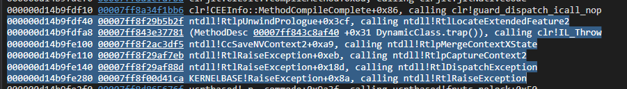

# 3lkToShell
A poor man's attempt to replicate the shellcode execution technique demo'd by [@0x3lk](https://x.com/0x3lk) during STHACK 2026 (https://www.youtube.com/watch?v=alRgpv-czyk)

> Disclaimer: I do not speak French beyond _"Aujourd'hui, maman est morte"_ - so this might not be a one-to-one translation of the technique - more like something inspired from it

## Usage

```
3lkToShell.exe /path/to/shellcode.bin
```

## Show me the stack 



Also, No _VirtualAlloc_ in the stack!

## Future Ideas 

Instead of running it from the exception clause, we can run it from a _filter_ but that has been left as an exercise for the reader ;)
